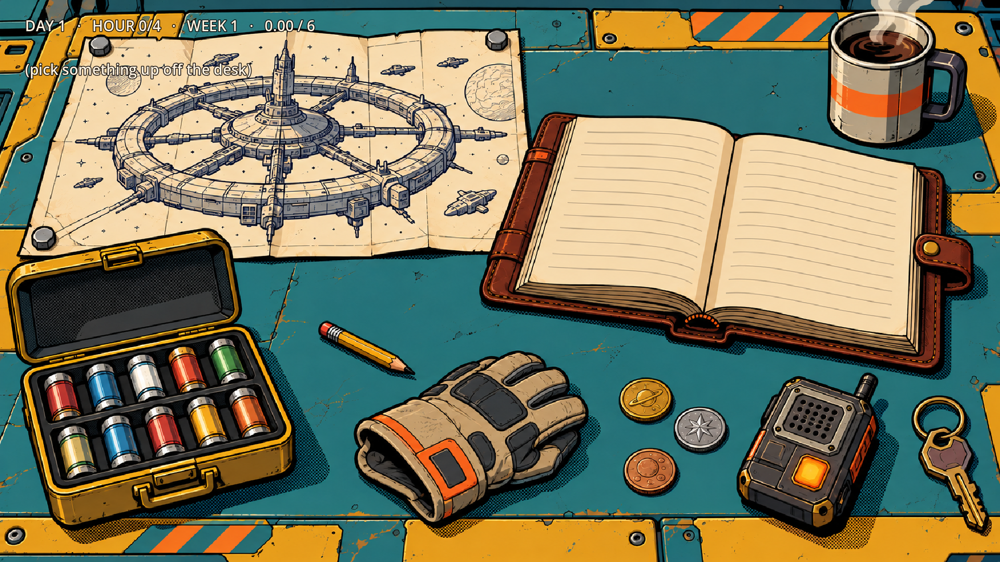
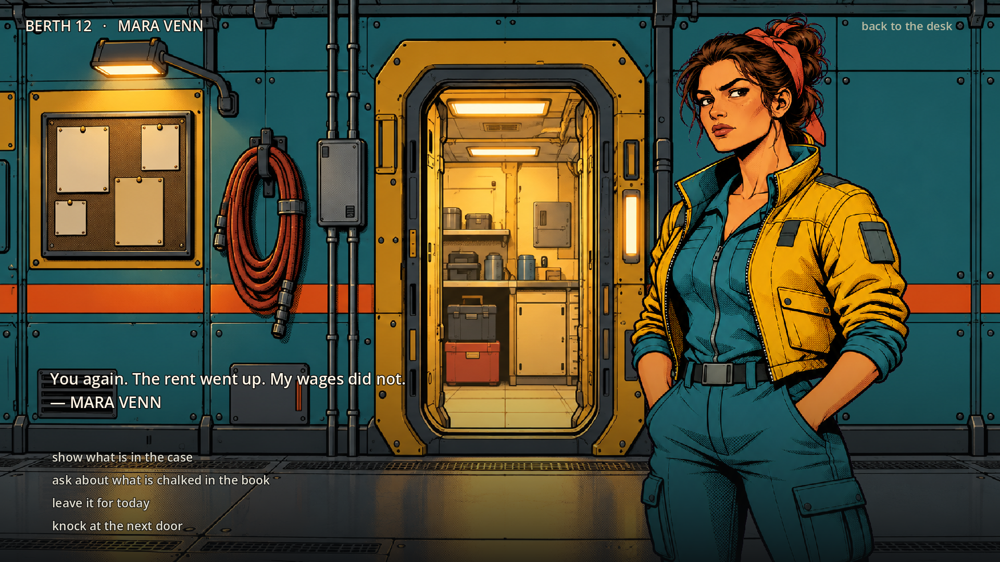
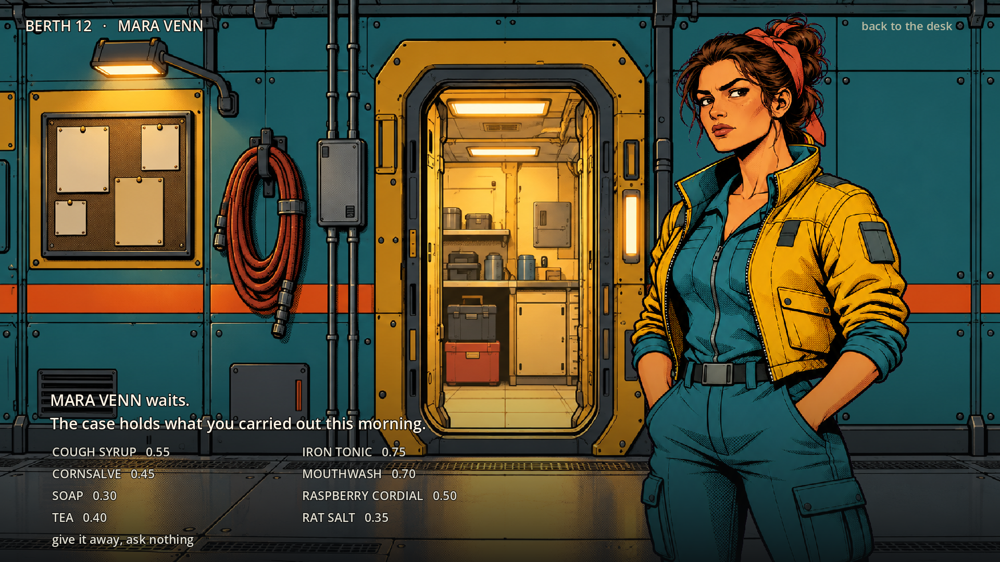
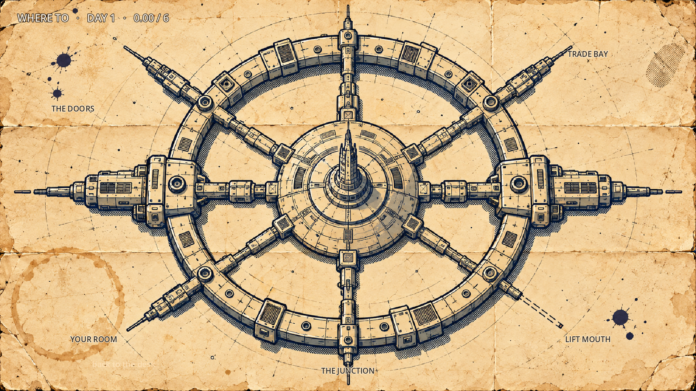
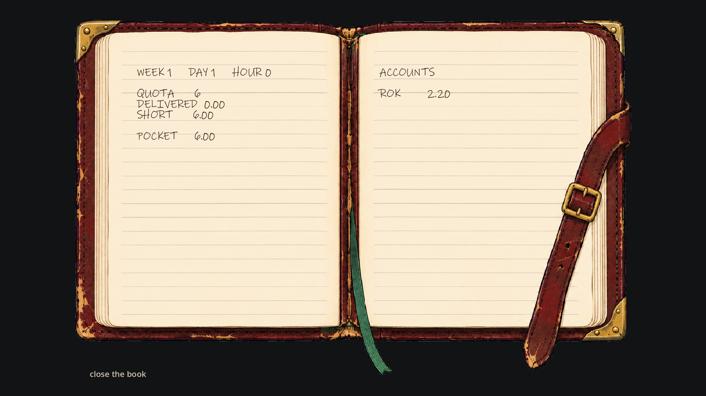
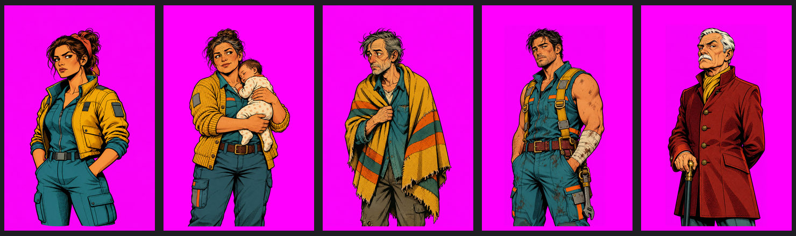
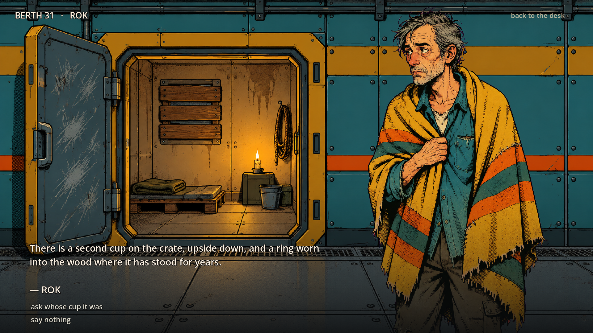

# Blue Blood

A door-to-door salesman on a freight habitat. You carry a case of small remedies,
a leather book, and a weekly quota. People pay when they can and owe you when they
cannot, and the chalk in your book does not fade.

The story keeps the shape of Alice Munro's *Walker Brothers Cowboy* — the route, the
credit, the small dignities — moved onto a working ring station.

## Screens

| screen | what it is |
| --- | --- |
| **Desk** | the hub. One painted still; every object on it is a hot spot |
| **Map** | the route map opened flat; five places, each on a spur |
| **Door** | an empty painted corridor with one resident standing in it, dialogue and choices |
| **Case** | what is in the sample case, offered to whoever is at the door |
| **Ledger** | the painted book, live numbers on the ruled lines |







The cast, on one canvas:



## Rules

- Eight goods, each with a price and the needs it answers.
- Five residents, each with cash, trust, a debt, their own doorway and their own voice.
- Reading the room is the game: a good that answers a need sells, a wrong guess costs trust.
- They pay in coin when the tin has anything in it and owe you when it does not.
- Debt can be asked for at the door. Whether they pay depends on trust and luck.
- They work, so money comes back: every night their pockets refill a little.
- Four hours to a day, seven days to a week. Quota is 6.00 the first week, +2.00 after.
- The week closes with a verdict: the number is made, or the shortfall goes in a letter.


## The neighbourhood

The route is not only a quota. Every household has a care score, raised when you
answer one of the needs they actually have: medicine for the sick child, a blanket,
tea for the man who has been alone too long.

- 0 needs answered — *cold*
- 1 — *barely holding*
- 2 — *steadier*
- 3 or more — *looked after*

The score is not a number on the screen. It shows up as their wages (a household that
is looked after earns more, and therefore pays you more), as the words the comms panel
uses for them, and as the junction itself: once the average rises past 1.5 the corridor
painting changes to a version where somebody has put a blanket on the bench, planted
three tins of greenery, filled the notice board and wired in a second lamp.

After four weeks the run closes with a page listing every household and what it became,
and one line about how much of the ring is warmer than it was.

## Dialogue

Every resident has depth rather than a single line.

- Four rotating greetings, chosen by how many times you have knocked.
- A separate remark for each need a good answers, so the same bottle lands
  differently in five rooms.
- One personal scene per resident, triggered on a later visit, with two choices
  that move trust and set a flag (the child behind the curtain, the second cup on
  Rok's crate, Dunn's badly wrapped hand, the empty tonic bottle on Halloran's shelf).
- Distinct voices for paid, owed, refused and asked-for-money moments.



## Saving

- Autosaves to `user://blueblood_save.json` after every sale, gift, collection,
  restock and day end, and again on any story choice.
- The game continues from the save on launch.
- "burn the book and start again" on the ledger page wipes it and starts a new run.

## Controls

- Mouse only. Hover an object on the desk to see what it is, click to open it.
- `Esc` returns to the desk.

## Art

Every surface is a painted image in `art/` — the interface is not drawn in code.

- The desk, the route map and the ledger are single stills.
- Corridors are painted empty; residents are separate portraits on a magenta ground,
  keyed to alpha and normalised to one canvas (1024x1536, figure 88% of the height,
  feet on the bottom edge) so a face can never drift between rooms.
- A painted gradient plate (`art/ui/scrim_bottom.png`) carries the dialogue so the words
  read over any background without a box around them.
- The three approved references live in `art/ref/`, with `PLAN.md` beside them.

## Running

Open the folder in Godot 4.7 and press Play.

Headless checks:

```
Godot --path . --resolution 1920x1080 -- --shot          # the desk
Godot --path . --resolution 1920x1080 -- --shot --map     # the map
Godot --path . --resolution 1920x1080 -- --shot --who=2   # a resident at their door
Godot --path . --resolution 1920x1080 -- --shot --pitch   # the case
Godot --path . --resolution 1920x1080 -- --shot --ledger  # the book
Godot --headless --path . -- --flowtest                   # two weeks of knocking, with assertions
Godot --headless --path . -- --savetest                   # save -> reset -> load round trip
Godot --headless --path . -- --playtest                   # every screen and action, end to end
Godot --path . -- --clicktest                             # real mouse events on every desk hot spot
```

`--flowtest` plays fourteen days automatically and fails on negative stock, negative
cash, a total owed that does not match the sum of debts, or weeks that do not advance.
It currently reports `PASS (0 failures)`.
